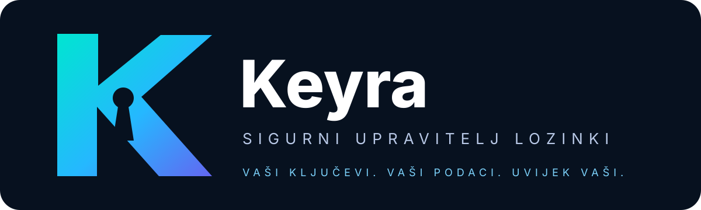
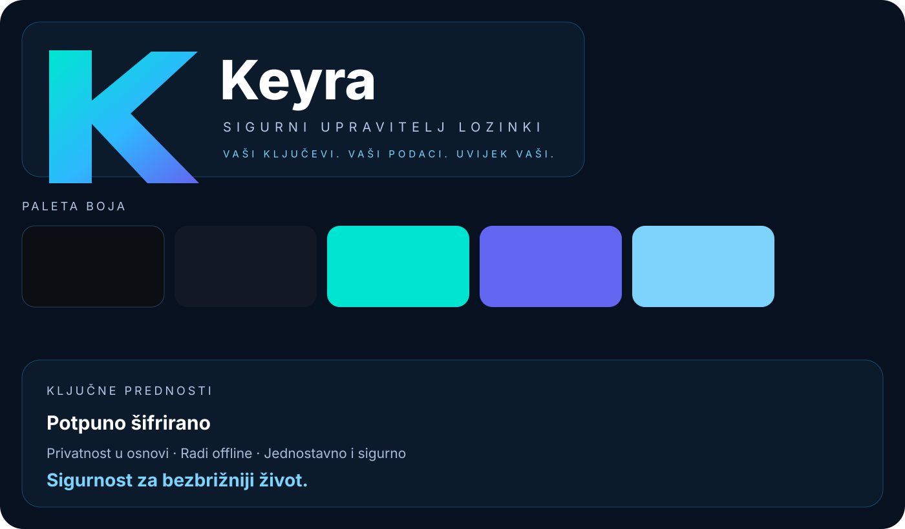
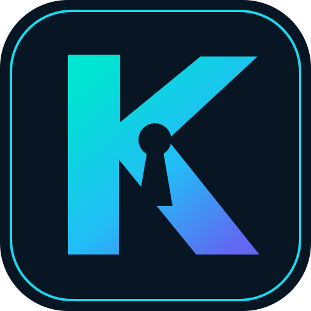

# One vault. Everything important.

### A more beautiful way to keep your digital life private.

**Keyra** brings passwords, authenticator codes, private notes, identities and important details together in a thoughtfully designed vault for **Android and iOS**.

No account. No ads. No subscriptions. No Keyra cloud account.

[**Get Keyra ↓**](https://github.com/bren-wp/Keyra/releases/latest) &nbsp;·&nbsp; [**Explore Keyra**](#made-for-the-things-that-matter) &nbsp;·&nbsp; [**Your privacy**](#private-by-design)

---

## Made for the things that matter

Your passwords should be easy to find and hard for anyone else to access. Keyra pairs a calm, dark interface with powerful, deliberately simple tools.

|  | Experience |
| --- | --- |
| 🔐 **Encrypted vault** | Keep your sensitive information protected with strong, on-device encryption. |
| 🗂️ **One place for everything** | Organize logins, secure notes, cards, identities and Wi-Fi details. |
| 🔎 **Find it fast** | Navigate your saved items with search, favorites and collections. |
| ✨ **Better passwords** | Generate stronger passwords with configurable length and character types. |
| ⏱️ **Authenticator codes** | Keep compatible time-based one-time codes alongside the accounts you use. |
| 🛡️ **Security insights** | Identify weak or reused passwords and other supported security warnings. |
| 👆 **Quick, protected access** | Use supported device authentication and automatic vault locking. |
| 📦 **Your own encrypted backup** | Export and import protected files whenever you choose. |
| 📄 **PDF vault overview** | Save an easy-to-read PDF report inside a ZIP, with item counts only and no secrets. |
| 🌐 **Your language, your choice** | Choose from 27 languages, including English and Croatian; key navigation and onboarding actions are translated and additional translations are being expanded. |

**Thoughtful design. Meaningful protection.**

Keyra's first-run screen lets you choose your language before creating a vault. Your language choice is stored only on your device. Translation coverage is growing across the app; some existing screens have not yet been localized.

## Private by design

Keyra works without requiring a Keyra user account or sending your vault to a Keyra server. Its core features are designed to work locally.

- **You stay in control:** your saved items remain in your local encrypted vault.
- **No ad tracking:** no advertising or analytics SDK is included in the current app.
- **No surprise sync:** backup export and import happen only when you choose to use them.
- **System-level protection:** Android Keystore and Apple Keychain help safeguard encryption keys.
- **Recovery with care:** a Recovery Key and an encrypted backup serve different purposes; preserve both securely if you need full recovery.

Your device and exported files still need protection. No security technology eliminates the risks of a compromised device or a weak master password.

[Privacy policy](PRIVACY.md) &nbsp;·&nbsp; [Security](SECURITY.md) &nbsp;·&nbsp; [Recovery Key guide](docs/RECOVERY_KEY.md)

## Get Keyra

### Available for Android and iOS

[**View the latest GitHub release →**](https://github.com/bren-wp/Keyra/releases/latest)

| Android | iOS |
| --- | --- |
| Download the Android testing APK from GitHub Releases. | The GitHub release provides a simulator package and an unsigned IPA for development/testing. |
| Store distribution requires a separately signed Android App Bundle. | Installing on an iPhone or publishing through the App Store requires Apple signing and provisioning. |

**Availability:** Keyra is distributed through GitHub Releases. The presence of a release package does not mean the app is already available on Google Play or the App Store.

## Questions, answered

**Is the PDF ZIP an encrypted backup?**  
No. The exported ZIP contains an unencrypted summary of item counts, without secrets or identifying fields. Use the separate encrypted .keyra file to back up vault contents.

**Can I use Keyra without registering?**  
Yes. Your core vault does not require a Keyra account.

**Does Keyra automatically synchronize my data?**  
No. You decide when and where to export an encrypted backup.

**Is the Recovery Key itself a backup?**  
No. A Recovery Key protects access to the portable vault key; an encrypted backup preserves the actual contents.

**Can I use the same backup across Android and iOS?**  
Keyra supports its portable encrypted backup format on both platforms. Test your backup and recovery process before relying on it for a device migration.

---

### Everything important. Beautifully protected.

*Privacy-first password management for Android and iOS.*

